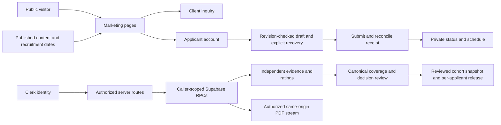

# October website and recruitment improvement

Date: 2026-10-16. Status: local implementation and verification complete; hosted integration and the user-requested100-agent acceptance panel outstanding.

## Direction contract

**Thesis:** make each next decision clear and support it with facts.
**Own world:** preserve Precision Instrument: navy, paper, orange, system sans prose, mono public metadata, hairlines, square actions. Apple-inspired review informs clarity and restraint; no Apple affiliation or endorsement.
**Story:** client question → organization proof → public work → engagement → capabilities → people → audience action. Recruitment explains eligibility, preparation and evaluation before account creation. Workspace state reflects what is actually confirmed.
**First viewport:** a concise proposition, client/student actions and an explanatory process figure. Essential content is server-rendered and usable without motion.
**Form:** editorial public pages, dense task-focused private workspaces; minimal client JavaScript for purposeful interaction, no decorative loops or new animation runtime.

## Workstreams

1. Public composition, navigation, footer, service information and recruitment guidance.
2. Complete page metadata and social cards; private routes inherit noindex; bounded public content requests.
3. Application save/recovery truthfulness, submission locks, photo persistence and ambiguous-result reconciliation.
4. Grading readiness, native keyboard controls, observation coverage, and confirmed submission receipts.
5. Board closing/selection review; caller-scoped deliberation visibility and same-origin PDF delivery.
6. Dependency patches, regression checks, responsive inspection and independent final review.

The initial 20 specialist tasks included five implementation owners and 15 design/research/review roles. Targeted follow-ups address confirmed review findings. They are AI specialists, not a panel of real participants. Raw point-in-time audits are in `docs/reviews/2026-10-redesign/`; their original line numbers/findings may be superseded by implementation.

## Reference decisions

The [Awwwards research](../reviews/2026-10-redesign/awwwards.md) examines Leva, Skaled and D.Potfer. Adopt explicit capability paths, named work, concrete handoffs and strong typography. Preserve MECG's identity and publication restrictions; do not copy another firm's metrics, stock artifacts or motion. [Apple-inspired review](../reviews/2026-10-redesign/apple-design.md) prioritizes hierarchy, simplified navigation, spacing, readable feedback and the engineering title block.

## Acceptance panel clarification

The user clarified that agents should act as the requested panel. The active review uses 100 independently spawned agents, 50 design/expert lenses and 50 intended-user lenses, on an immutable source/evidence snapshot. The panel brief and seats are in `docs/reviews/2026-10-redesign/panel-100/`. Each verdict remains independent; conditional, missing or unproven results do not establish unanimous agreement. Agent reviews are labeled as AI evaluations, with no claims of real credentials or human endorsement. The historical human-study protocol remains available for future actual usability research.

## Release boundaries

No deployment or production migration is part of this working-tree revision. Local fixtures use no live credentials. Staging must exercise Clerk sessions, Supabase policies/storage, draft races, email delivery and operator workflows. Weights, quorum and policy decisions require their existing Board process. Approved case-study content and actual project artifacts remain content-owner dependencies.

## System boundaries

Identity, authorization, persistence and delivery are separate boundaries. A UI receipt must reflect a confirmed result; observation summaries do not establish a completed decision score.

Verification: [implementation receipt](../reviews/2026-10-redesign/implementation-receipt.md), [independent final review](../reviews/2026-10-redesign/final-review.md), [open items](../reviews/2026-10-redesign/release-open-items.md).

Continuation verification adds real isolated PostgreSQL coverage, concurrent draft-save proof and a production publication/withdrawal check. The [participant protocol](../research/participant-study/PROTOCOL.md) and blank evidence template prepare the genuine acceptance phase; no participant agreement has been collected.
