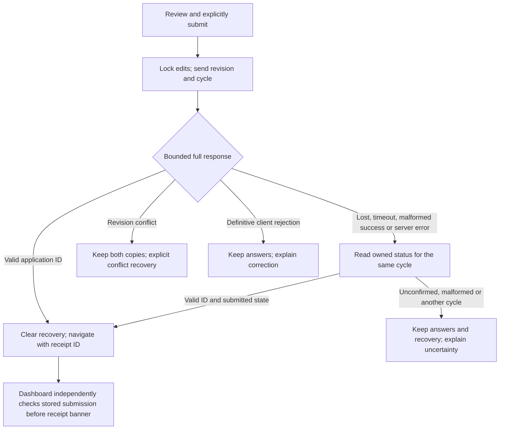
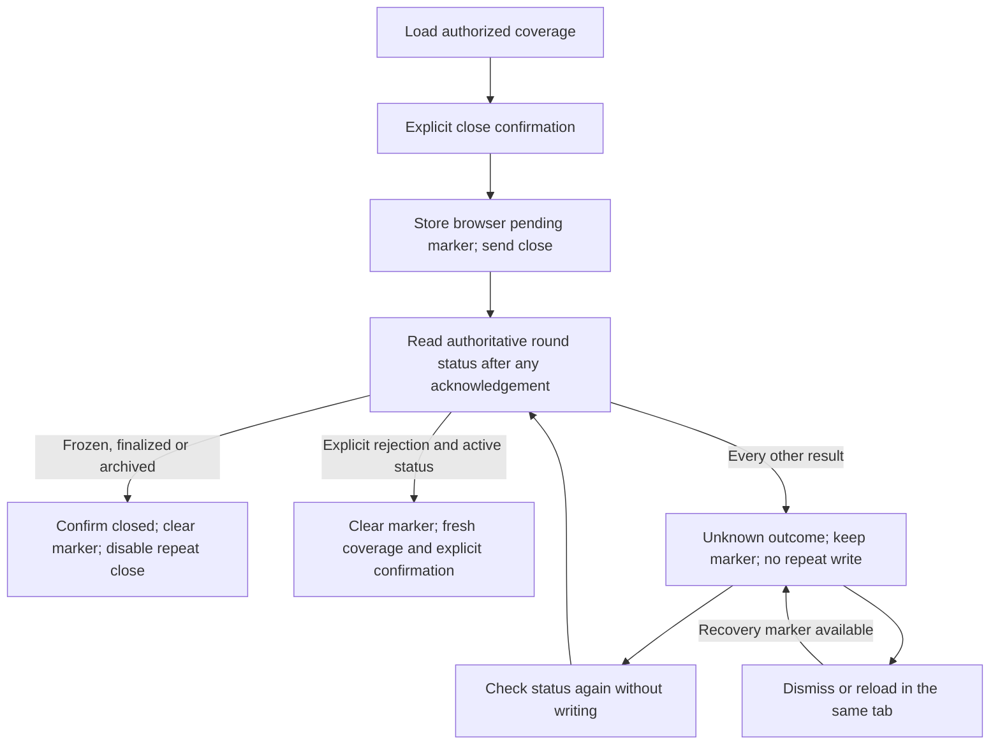
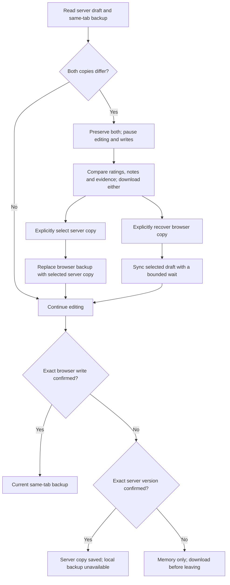

# Acknowledgement and recovery states

2026-10-16. These diagrams describe the current implementation. They are engineering review aids, not hosted acceptance evidence or panel votes. See `../reviews/2026-10-redesign/submission-receipts-and-deadlines.md` for actual verification.

## Applicant submission

HTTP success alone is not a receipt. A prior cycle's submission cannot confirm this form. A negative status read does not prove the attempted write failed.

## Closing grading

The recovery marker is browser storage, not a server operation ledger. It can be unavailable or cleared. An active read by itself cannot resolve an ambiguous write: that transaction may still commit. Local and cross-engine fixtures exercise these states; hosted permissions, transactions, sessions and actual operator acceptance remain separate checks.

## Evaluator recovery

Copies are selected, not automatically merged. Local backup retention is up to24hours in the current tab. A timestamp receipt acknowledges a server save, not a revision/CAS guarantee against concurrent server writers.

## Combining application copies

```mermaid
stateDiagram-v2
    [*] --> Comparing: Browser differs or revision conflict
    Comparing --> PrivateBackup: Download both copies
    PrivateBackup --> Comparing: Check local download
    Comparing --> Choosing: Select saved/browser version per changed field
    Choosing --> Editing: Continue with combined answers
    Comparing --> Editing: Explicit whole-copy choice
    Editing --> Saving: Consent cleared; reviewed revision retained
    Saving --> Editing: Confirmed new revision
    Saving --> Comparing: Another concurrent change
    Saving --> Uncertain: Receipt unavailable
    Uncertain --> Saving: Retry the exact mutation
```

No write occurs while comparison is unresolved. A private export does not submit the application or download attachment bytes. A combination chooses exact existing text; it does not infer which copy is newer or rewrite responses.
