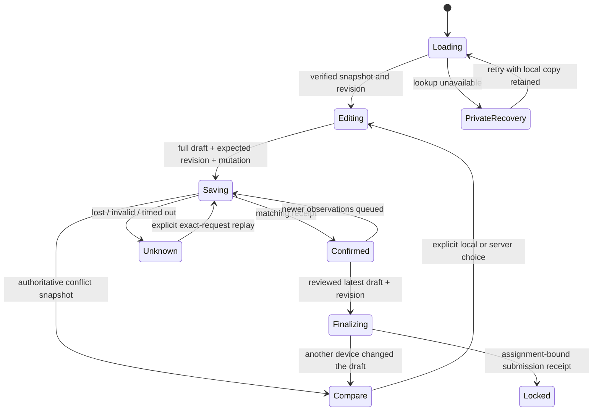

# Generic evaluation draft concurrency and final submission

2026-10-16. Current-tree interface/API follow-up to the grading recovery review. Frozen panel snapshots and their votes remain unchanged.

Generic written evaluations now consume the revision-safe get/save/submit RPCs described in [the database receipt](evaluation-draft-write-revisions.md). This interface change preserves the existing rubric ratings, required observations, note validation, review step, local private backup, explicit copy comparison, and final scoring rules.

## Recovery behavior

A loaded draft carries its assignment identity and UUID revision. A content-present draft must have a revision; a null current-rubric draft can retain an existing UUID revision when older-rubric content exists, matching the actual SQL contract. Invalid or mismatched receipts do not confirm saving.

Each editor serializes draft requests. Editing cancels only a pending debounce timer, never an already-started write. An unknown result retains the exact payload, expected revision and mutation UUID. Explicit Retry confirms that same request before sending newer edits under its returned revision. An earlier receipt never replaces newer local text. Queued calls recheck the lock after waiting and do not carry retry permission into a newly unknown result. Unmount stops subsequent queued writes, and assignment-keyed editors prevent local state reuse across assignments. Equivalent rubric prop objects do not reload and replace an active draft.

A 409 snapshot pauses editing and opens the existing comparison interface with both copies retained. The heading receives focus; private downloads remain available. Choosing the local copy saves it under the observed server revision. Choosing the server copy replaces the browser copy deliberately. Both return focus to the first criterion. There is no automatic merge or inference that the browser copy is newer.

An unavailable initial lookup permits editing and a private backup, but cannot authorize a write or final lock without an authoritative revision. Retry performs an in-page lookup while preserving current memory-only observations for comparison; it does not reload and discard them. Browser backup status still reflects actual storage writes, including blocked access and quota failures. Backups remain scoped to the existing 24-hour browser-tab format. Pending mutation identity is held in memory; the stored recovery copy contains observations, not a cross-reload replay ledger.

## Final submission and API boundaries

Confirm and lock first waits for the latest draft to be confirmed. It refuses while revision, unknown-save, or conflict recovery remains unresolved. The final API passes the confirmed draft revision to `submit_evaluation_v2`; the database checks it under the same assignment lock as draft saving. A changed draft between review and submission returns an explicit comparison instead of finalizing stale observations.

The submitted receipt must bind the exact assignment, evaluation identifier and finite score. Unknown or malformed final results retain local observations and tell the evaluator to refresh My work before retrying because the assignment may already be locked. They do not assert that it remains open. Known client validation errors retain their useful details.

GET/PUT use validated v2 payloads, including explicit nullable expected revision and required mutation UUID. Authenticated DELETE is explicitly unavailable (405 with `Allow: GET, PUT`); unauthenticated DELETE retains the shared 401 boundary. No form consumer used DELETE, and final cleanup remains atomic in SQL. Production error logs contain codes rather than private notes or provider error objects.

## Pointer interaction finding and repair

The first full matrix passed 98 checks and failed two new deterministic pointer checks on desktop and mobile WebKit. A save error arriving between pointer down and up expanded feedback above the rating controls; the intended radio remained unchecked. Chromium, mobile Chromium and Firefox passed the same sequence. The original one-case diagnostic initially had an ambiguous test locator; that locator was corrected before behavior was observed. Both diagnostic logs remain available.

Full live save/recovery/backup feedback now appears below editable controls, with a short, stable-height visual status above. Native rating targets stay in place when asynchronous receipts arrive. No browser-specific workaround or scoring-input replacement was added. The unchanged pointer sequence passes across all five configurations after the repair.

## Verification

- **19/19 focused Node tests passed**: request/snapshot/receipt parsing, old-rubric null-content handling, v2 draft API forwarding and conflicts, missing-revision rejection, DELETE retirement, exact final-assignment binding, final conflict behavior, and honest uncertainty copy. [Raw Node log](evidence/evaluation-cas-node.log).
- Focused ESLint, `npx tsc --noEmit`, and `git diff --check` passed. Broader build/Node checks belong to the root integration receipt.
- Initial Chromium pass: **18/18** before the added body-stall, pointer, and final-uncertainty cases. [Initial log](evidence/evaluation-cas-initial-chromium.log).
- Pre-repair full matrix: **98 passed, 2 failed**, both real WebKit pointer checks. [Retained failing log](evidence/evaluation-cas-before-geometry.log); traces under `.audit/evaluation-cas-final/`.
- Final current interface: **110/110 browser checks passed** (22 scenarios × five configurations) in 1.1 minutes. [Final browser log](evidence/evaluation-cas-browser.log). Docker Playwright 1.64.1; Chromium desktop/Pixel 7, Firefox desktop, WebKit desktop/iPhone 13; synthetic localhost:3000 dev server; two workers.

The final run includes all eleven existing backup/review/deadline scenarios, eight new CAS scenarios, the pointer race, and two unknown final-receipt scenarios. It exercises delayed earlier-save/newer-edit ordering, exact replay after lost transport and a nonsettling JSON body, both explicit conflict choices and private downloads, latest-save-before-lock, another-device change before locking, initial revision outage, blocked/quota-limited browser storage, native keyboard review, and retained observations after malformed or closed-conflict final receipts.

These browser tests use synthetic requests and virtual input, including mobile viewport emulation. They do not prove hosted Clerk/Supabase integration, physical iPhone behavior, an assistive-technology session, human acceptance, or a new panel endorsement. The independent database receipt records 821 SQL assertions and three real two-connection lock experiments; those are separate evidence, not part of the browser count.
