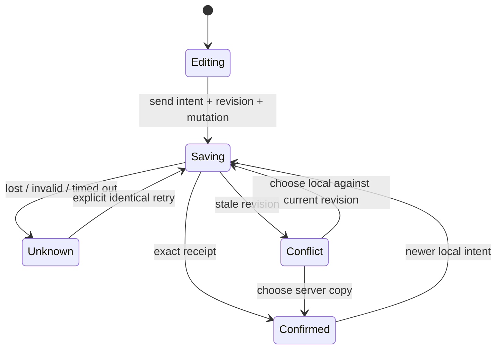

# Group Case revision and recovery integration

This later working tree addresses V2 seat071 and independent implementation-review findings. It does not change the frozen V2 snapshot, panel votes or claim panel consensus.

Every applicant row carries its own confirmed revision. A save sends that revision, a fresh mutation UUID and the full observation intent. One request per applicant drains before another begins. Newer local edits remain visible while an earlier request is pending. Confirmed receipts must match the exact applicant and mutation. The client updates its confirmed revision before sending a newer intent.

A 15-second deadline includes consuming JSON. Lost, malformed, stalled or server-failure results keep the exact pending request; they do not prove failure or authorize a fresh write. Explicit retry resends that exact mutation. Once confirmed, the latest local intent can save using the returned revision. Queued edits never automatically replay an unknown request. Even clearing all local observations after an unknown first save leaves exact retry available.

A stale revision returns the current server copy without overwriting either intent. The affected applicant becomes visible, the comparison heading receives focus, and editing pauses until the grader explicitly chooses a copy. Choosing the local copy writes against the newly confirmed server revision; choosing the server copy restores it without a write. Focus returns to the applicant control. A private JSON download includes local observations, last confirmed observations, pending request and conflicting server copy. The page warns about personal data and unconfirmed changes before leaving. The direct Read the rubric navigation also warns when observations are unconfirmed, so cancelling keeps the observations open. Native unload protection is supplementary; these scoped guards do not provide general cross-navigation or durable-backup guarantees. The rubric-navigation follow-up passed a separate **40/40** browser run alongside the seven existing revision scenarios, across the same five configurations. This covers95distinct Group Case checks across the90-check and40-check runs, not a single95-check run. The final follow-up also verifies the latest render-state retry guard; ESLint rejects ref reads during rendering, so that guard now derives from explicit unknown status.

Receipt-driven feedback cannot shift star hit targets: the header status keeps a fixed line and changing quality/recovery text follows the rating controls. This repairs a browser-reproduced pointer-down/receipt/pointer-up missed-click race without changing pointer cancellation semantics.

## Verification status

SQL verification is recorded separately in [group-case-write-revisions.md](group-case-write-revisions.md); durable raw inputs and logs are in [evidence/group-case-write-revisions/](evidence/group-case-write-revisions/). The final single browser run passed **90/90 checks** across desktop Chromium, mobile Chromium, Firefox, WebKit and mobile WebKit, including evidence, revision recovery and read-only states. The focused API/helper/SSR checks passed **30/30**. See [group-case-v2-integration-tests.md](group-case-v2-integration-tests.md) for raw logs, source/harness corrections and current mobile captures. Root TypeScript and focused ESLint passed; the full working-tree Node run passed **811/811**, and the production build and full ESLint also passed at this recorded checkpoint; evaluator-specific follow-up will be verified separately. These are local scoped checks, not a single aggregate browser run for the entire site. Hosted providers, actual assistive technology and physical devices remain unverified.
